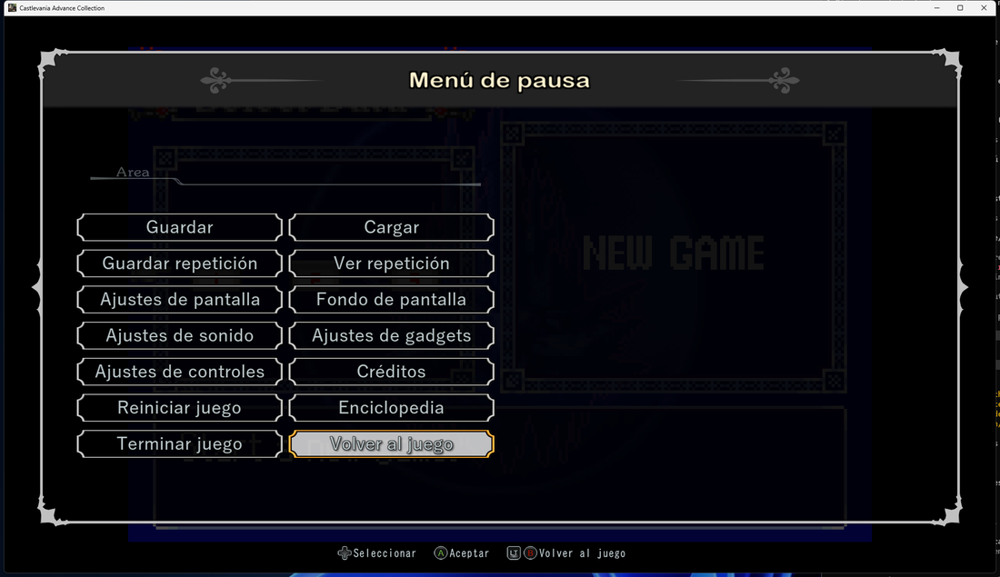
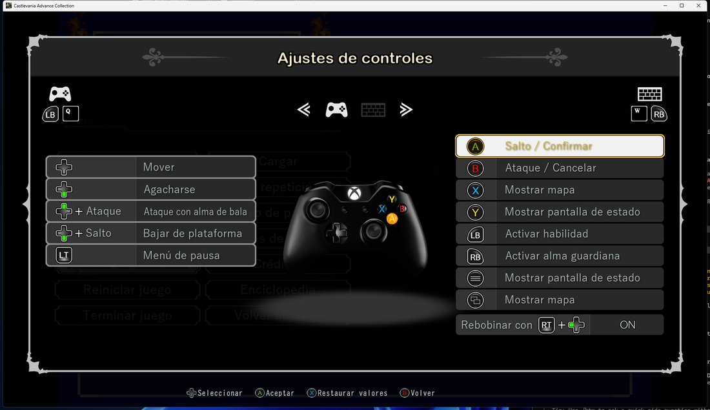
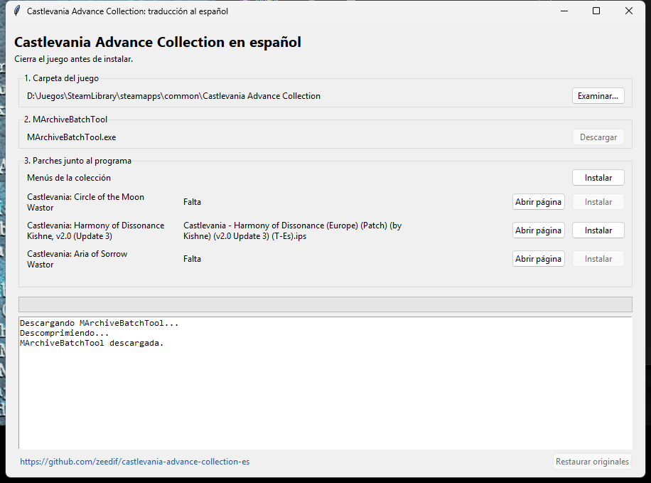

# Castlevania Advance Collection en español

Instalador con interfaz gráfica que deja **Castlevania Advance Collection** (Steam) en español: los tres juegos de GBA que incluye (*Circle of the Moon*, *Harmony of Dissonance* y *Aria of Sorrow*) con las traducciones de la comunidad, y además **los menús de la colección** (pausa, ajustes, carrusel, reproductor de música, pantallas de carga…) con sus tildes y la ñ.

> Proyecto de aficionados, sin relación con Konami. **No incluye ningún juego, ROM ni parche de terceros**: necesitas tener el juego en Steam y descargar los parches de sus autores (los enlaces están más abajo).

## Qué hace

1. Abre el archivo de datos del juego (`alldata.bin`) con [MArchiveBatchTool](https://github.com/farmerbb/RED-Project/releases/tag/tools) (el instalador la descarga solo si no la tienes).
2. Aplica los parches `.ips` de los traductores a las ROMs de GBA que lleva la colección. Los parches de *Harmony* y *Aria* chocan con dos bloques de código que Konami añadió a esas ROMs, así que antes se reubican (se comprueba byte a byte que el resultado es el mismo que aplicar el parche sobre la ROM original).
3. Traduce los menús de la colección: imágenes con texto ya dibujado (menú de pausa, nombres de áreas, controles, enciclopedia, carrusel, historias de cada juego, carga…), textos de los menús y avisos, y las tildes y la ñ de las fuentes del juego.
4. Reconstruye el archivo del juego. Antes guarda una **copia de seguridad** de los dos archivos originales en la carpeta `backup`, junto al instalador.

Todo ocurre en tu equipo y sobre tus propios archivos; en el repositorio solo hay código y los textos/imágenes en español dibujados desde cero.

| Menú de pausa | Ajustes de controles |
|---|---|
|  |  |

## Qué necesitas

- Windows 10/11 (en Linux o Steam Deck debería funcionar con Python, ver más abajo; sin probar).
- **Castlevania Advance Collection** de Steam, versión 1.0.0, sin modificar. Si ya la tocaste, usa *Propiedades → Archivos instalados → Verificar la integridad de los archivos del juego* en Steam.
- Los parches de traducción (se reconocen **por su contenido**, el nombre del archivo da igual):

| Juego | Traducción | Dónde conseguirla |
|---|---|---|
| Castlevania: Circle of the Moon (versión americana) | Wastor, v1.0 | [wastor.romhackhispano.org/castlevania-circle-of-the-moon](https://wastor.romhackhispano.org/castlevania-circle-of-the-moon/) |
| Castlevania: Harmony of Dissonance (versión europea) | Kishne, v2.0 (Update 3) | [MediaFire](https://www.mediafire.com/download/6cts4vbaath6sa7/Castlevania+-+Harmony+of+Dissonance+2.0+%28Update+3%29+~+By+Kishne.rar) |
| Castlevania: Aria of Sorrow (versión europea) | Wastor, v1.0 | [wastor.romhackhispano.org/castlevania-aria-of-sorrow](https://wastor.romhackhispano.org/castlevania-aria-of-sorrow/) |

No hace falta instalar los tres: el instalador usa los que encuentre.

## Cómo se usa

1. Descarga `CastlevaniaAdvanceES.exe` de la [última versión](../../releases/latest) y ponlo en una carpeta propia, por ejemplo `Escritorio\CastlevaniaES`.
2. **Deja en esa misma carpeta** los parches que descargaste (los `.ips`, o el `.zip`/`.rar`/`.7z` tal cual los bajaste). No hace falta descomprimir ni crear subcarpetas, y no se buscan en otras carpetas.
3. Cierra el juego y abre `CastlevaniaAdvanceES.exe`.
4. El programa encuentra solo la carpeta del juego (si no, pulsa *Examinar*) y avisa de qué parches ha reconocido. Si no tienes MArchiveBatchTool, pulsa **Descargar**: se baja y se guarda junto al programa.
5. Pulsa **Instalar**. Tarda unos 20-30 segundos.
6. Abre el juego, entra en **Versión del juego** (el icono del globo, al final del carrusel) y elige la versión que se tradujo: *americana* para Circle of the Moon, *europea* para Harmony y Aria. En *Aria of Sorrow* elige «Español» en su pantalla de idioma.



Para volver a lo de fábrica pulsa **Restaurar originales** (devuelve la copia de la carpeta `backup`) o usa *Verificar la integridad de los archivos* en Steam. Si Steam actualiza el juego, vuelve a ejecutar el instalador (restaura antes si da un aviso de que la ROM no es la original).

### Idioma de Steam

Los menús se escriben en el idioma «español (España)» y también en el inglés, que es el que usa el juego cuando Steam está en un idioma que la colección no trae (por ejemplo el español latinoamericano). Si en Steam tienes francés, alemán, italiano o japonés, esos menús seguirán en esos idiomas.

## Qué queda sin traducir

- Las descripciones de la **enciclopedia** (objetos, equipo y enemigos de cada juego) siguen en inglés; los títulos, pestañas y etiquetas sí están en español.
- Las páginas de los **manuales** que se ven en la colección son imágenes con su propio diseño y no se tocan.
- Nombres de canciones y de los juegos, créditos y los textos japoneses de la versión japonesa.

## Línea de comandos

```
python instalar.py --cli [--game "<carpeta del juego>"] [--sin-menus]
python instalar.py --restaurar [--game "<carpeta del juego>"]
```

Sin argumentos se abre la interfaz gráfica. En Linux hace falta Python 3 (y `tkinter` para la ventana; si no está, usa `--cli`); la herramienta se descarga en su versión para Linux. Esa parte no la he probado.

## Cómo compilarlo tú mismo

Hace falta Python 3.10 o superior con `tkinter`.

```powershell
.\construir.ps1        # crea dist\CastlevaniaAdvanceES.exe (PyInstaller, sin ventana de consola)
```

Los datos que lleva el programa se generan con las herramientas de `herramientas/`:

- `datos_roms.py` crea `datos.json`: huellas SHA-1 de las ROMs de la colección y de los parches, y los rangos de bytes que Konami modificó (sin copiar ningún dato de las ROMs).
- `menus_build.py` crea `menus_es.dat`: dibuja con fuentes de Windows los textos en español (`menus_textos.py` y `menus_ui.py` tienen las traducciones) midiendo antes los gráficos originales del propio juego para igualar tamaño, color y posición. Necesita `pillow` y `numpy`.

## Créditos

- **Wastor** ([El ático de Wastor](https://wastor.romhackhispano.org/)): traducciones de *Circle of the Moon* y *Aria of Sorrow*.
- **Kishne**: traducción de *Harmony of Dissonance*.
- **MArchiveBatchTool**: herramienta para abrir y reconstruir los archivos `.m` de los juegos de M2 ([versión de farmerbb](https://github.com/farmerbb/RED-Project/releases/tag/tools)).
- Castlevania es una marca de Konami Digital Entertainment. Este proyecto no está afiliado ni respaldado por Konami.

Licencia del código y de los textos propios: [MIT](LICENSE).
